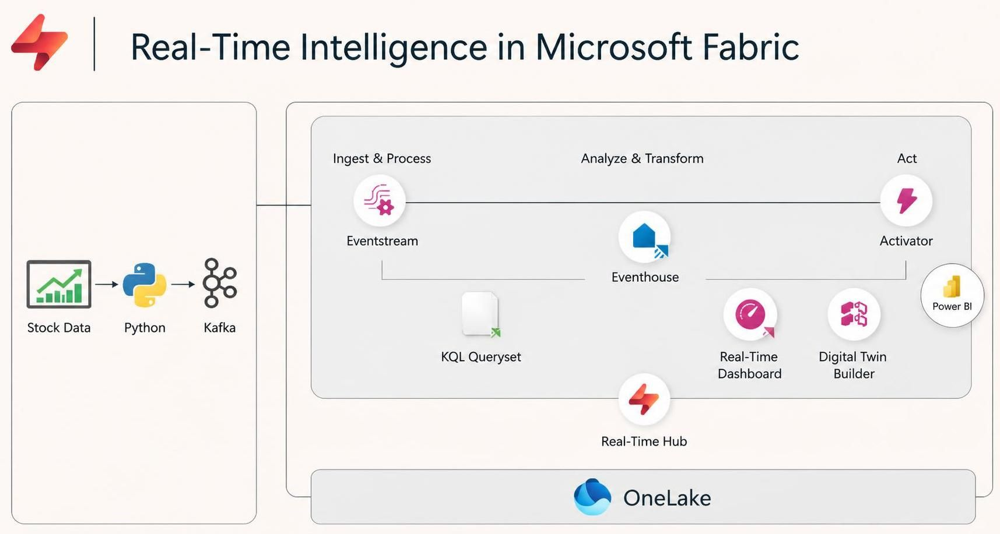
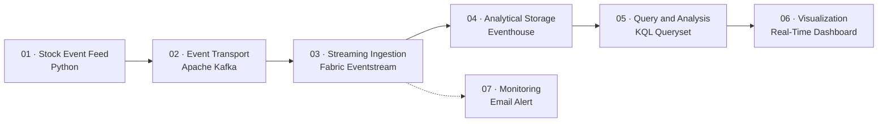
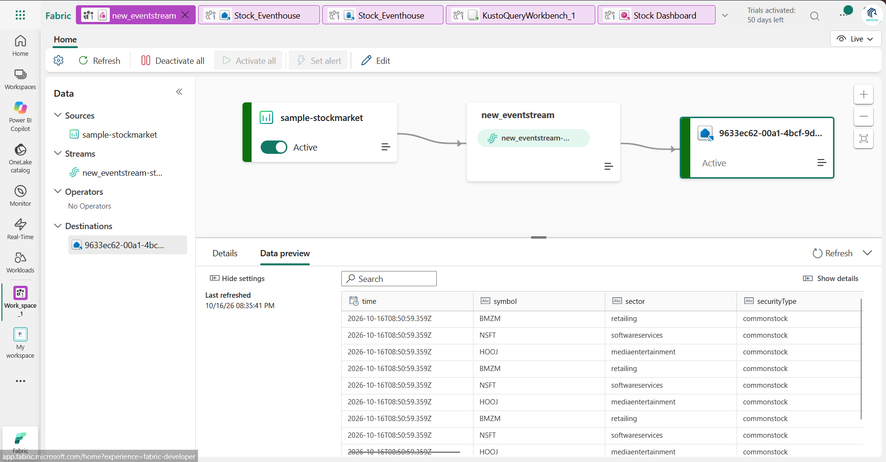
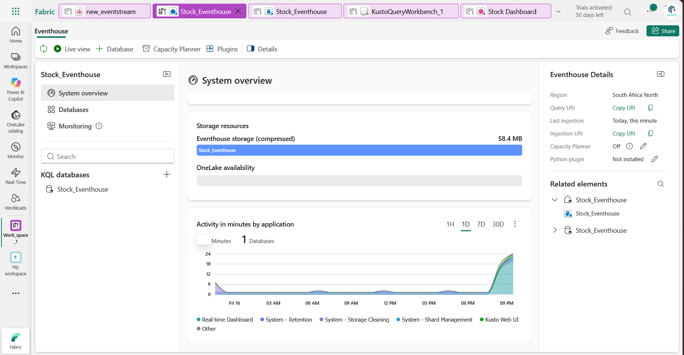
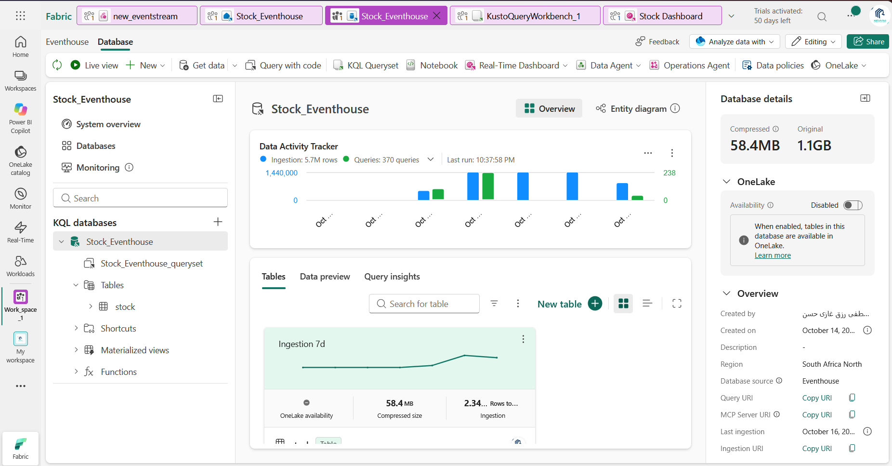
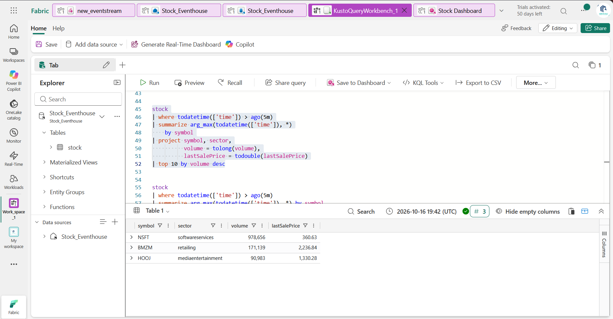
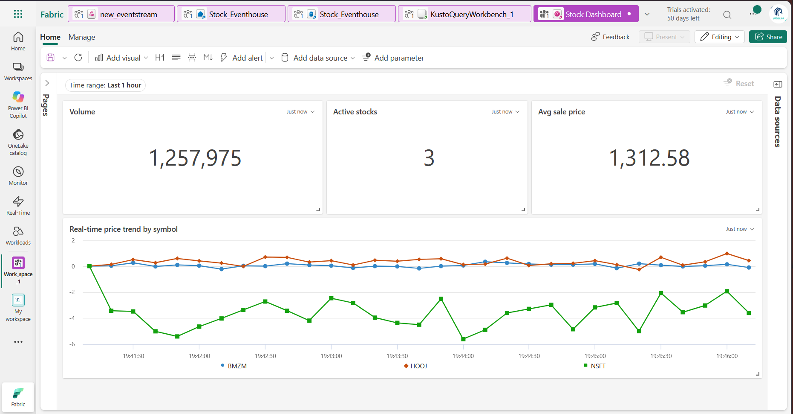
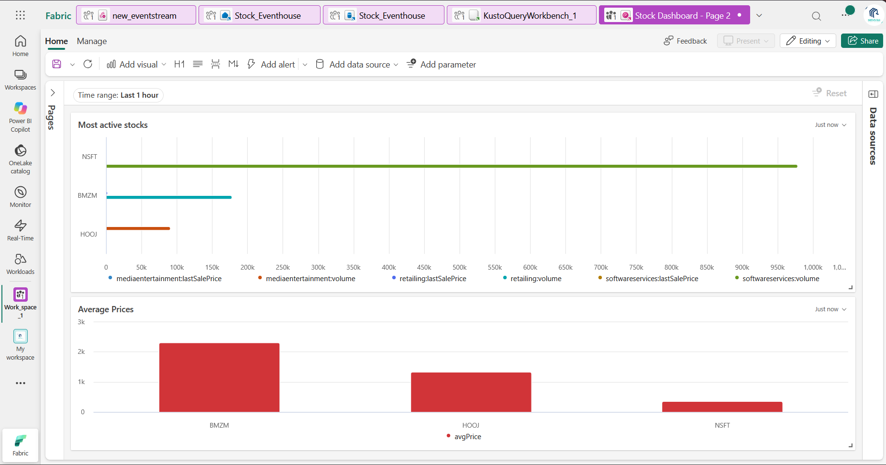
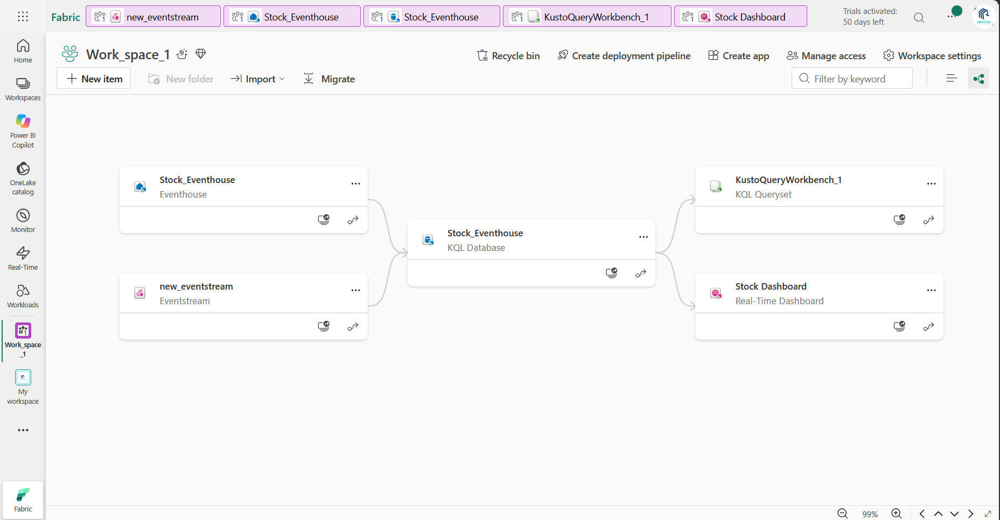

# 📈 Real-Time Stock Market Analytics with Microsoft Fabric

### From Streaming Stock Events to Real-Time Insights and Alerts

An end-to-end **Real-Time Intelligence project** demonstrating how streaming stock-market events can be ingested, analyzed, visualized, and monitored using Apache Kafka and Microsoft Fabric.

The solution combines event streaming, real-time analytical storage, Kusto Query Language (KQL), interactive dashboards, and email alerting in a unified data engineering workflow.

**Project focus:** Streaming Data Engineering · Real-Time Analytics · Event-Driven Architecture · KQL · Microsoft Fabric

---

## 📑 Table of Contents

1. [Project Overview](#-project-overview)
2. [Solution Architecture](#-solution-architecture)
3. [Eventstream: Streaming Ingestion and Routing](#-eventstream-streaming-ingestion-and-routing)
4. [Real-Time Analytics with KQL](#-real-time-analytics-with-kql)
5. [Real-Time Dashboard and Monitoring](#-real-time-dashboard-and-monitoring)
6. [Data Lineage and Fabric Workspace](#-data-lineage-and-fabric-workspace)
7. [Technology Stack](#-technology-stack)
8. [Repository Structure](#-repository-structure)
9. [Key Engineering Concepts](#-key-engineering-concepts)
10. [Limitations and Future Improvements](#-limitations-and-future-improvements)
11. [Author](#-author)

---

## 🎯 Project Overview

Modern data platforms increasingly need to process continuous streams of events instead of relying exclusively on traditional batch-processing workflows.

This project explores how **Microsoft Fabric Real-Time Intelligence** can support a streaming analytics solution that transforms incoming stock-market events into useful monitoring insights.

Using Python-generated sample stock data and Apache Kafka, events flow through Microsoft Fabric Eventstream into Eventhouse, where KQL queries analyze recent activity. The results are then presented through a Real-Time Dashboard, with email alerting configured for abnormal event frequency.

### Project Objectives

- Build an end-to-end streaming analytics architecture.
- Ingest and route stock-market events through Microsoft Fabric Eventstream.
- Store and query streaming data using Eventhouse.
- Develop KQL queries for time-based aggregation and market-event analysis.
- Visualize stock metrics through a Real-Time Dashboard.
- Configure email alerts to monitor abnormal event frequency.
- Understand how ingestion, analytical storage, querying, visualization, and monitoring connect within Microsoft Fabric.

---

## 🏗️ Solution Architecture

The solution follows a streaming-first architecture, connecting event production to analytical insights and operational monitoring.



### End-to-End Data Flow



### Architecture Components

| Stage | Component | Responsibility |
|---|---|---|
| 01 | Python Stock Feed | Generates sample stock-market events. |
| 02 | Apache Kafka | Transports events to the streaming ingestion layer. |
| 03 | Microsoft Fabric Eventstream | Ingests and routes incoming events. |
| 04 | Eventhouse | Stores streaming events and provides a KQL-queryable environment. |
| 05 | KQL Queryset | Filters, aggregates, and analyzes recent events. |
| 06 | Real-Time Dashboard | Visualizes key metrics and stock-price trends. |
| 07 | Email Alert | Notifies when the configured abnormal event-frequency condition is met. |

### Sample Event Schema

The incoming events contain fields representing stock prices, trading activity, and event timestamps.

| Field | Description |
|---|---|
| `time` | Event timestamp |
| `symbol` | Stock ticker symbol |
| `sector` | Industry or market sector |
| `securityType` | Security classification |
| `bidPrice` | Reported bid price |
| `bidSize` | Reported bid quantity |
| `askPrice` | Reported ask price |
| `askSize` | Reported ask quantity |
| `lastSalePrice` | Most recently reported sale price |
| `lastSaleSize` | Quantity associated with the last sale |
| `volume` | Reported trading volume |
| `marketPercent` | Market-related percentage field from the source |
| `seq` | Event sequence field |
| `lastUpdated` | Last-update timestamp |
| `lastSaleTime` | Last-sale timestamp |

These attributes provide the basis for time-window analysis, symbol comparisons, volume indicators, bid-ask spread calculations, and data-quality monitoring.

---

## ⚡ Eventstream: Streaming Ingestion and Routing



Microsoft Fabric Eventstream is the streaming ingestion and routing component of the solution.

It connects the incoming event stream to the destination used for downstream analytics, providing the bridge between the event source and the Fabric real-time analytics environment.

### Implementation Focus

- Connect the incoming stock-event stream.
- Ingest and route events through Fabric Eventstream.
- Integrate the streaming ingestion layer with Eventhouse.
- Make incoming events available for downstream KQL analysis.

### Why Eventstream Matters

In a streaming architecture, ingestion and routing determine how incoming events reach the analytical layer.

Eventstream provides the integration point between the event producer and the Fabric environment, allowing the solution to move beyond manually uploaded datasets toward a continuous event-processing workflow.

**Screenshot:** The Eventstream configuration should show the actual source, destination, and routing path used in this implementation.

---
### 🏠 Eventhouse and KQL Database: Real-Time Data Storage

After events are ingested and routed through Microsoft Fabric Eventstream, Eventhouse provides the analytical storage environment where the incoming stock-market data can be stored and queried for real-time analysis.

The Eventhouse contains a KQL Database, which provides the database context for organizing and querying the event data using Kusto Query Language (KQL).

## Eventhouse: Analytical Storage Layer

Eventhouse serves as the central analytical storage component in this solution. It supports the storage and exploration of streaming event data and enables downstream analytics without requiring the data to be exported to a separate analytical engine.

In this project, Eventhouse is used to make incoming stock-event records available for querying and dashboard development.

Key responsibilities:

Receive and store events routed from the Eventstream.
Provide an analytical environment for exploring stock-market event data.
Support time-based filtering and aggregation over recent events.
Make event data available to KQL queries and downstream visualizations.




## 🔍 Real-Time Analytics with KQL



Once events are available in Eventhouse, **Kusto Query Language (KQL)** is used to analyze recent data, aggregate metrics, compare stock symbols, and prepare results for visualization.

The analytical approach focuses on time-window filtering, time-binned aggregation, latest-snapshot analysis, and quote-quality checks.

### 1. Latest-Snapshot KPI Summary

This query retrieves the latest record for each stock symbol within the last five minutes and calculates summary indicators.

```kusto
stock
| where todatetime(['time']) > ago(5m)
| summarize arg_max(todatetime(['time']), *) by symbol
| summarize
    activeStocks = dcount(symbol),
    totalReportedVolume = sum(tolong(volume)),
    averageSalePrice = round(avg(todouble(lastSalePrice)), 2),
    validQuotes = countif(
        todouble(bidPrice) > 0 and todouble(askPrice) > 0
    )
```

**Metrics produced:**

- `activeStocks`: Number of distinct stock symbols in the latest snapshot set.
- `totalReportedVolume`: Sum of the latest reported volume for each symbol.
- `averageSalePrice`: Average last-sale price, rounded to two decimal places.
- `validQuotes`: Number of records with positive bid and ask prices.

**Important:** If `volume` represents cumulative daily volume, `totalReportedVolume` is not the amount traded during the last five minutes. It is the sum of the latest reported volume values across the selected symbols.

### 2. Real-Time Price Trend by Symbol

This query aggregates observed sale prices into ten-second intervals to produce a time series suitable for a line chart.

```kusto
stock
| where todatetime(['time']) > ago(5m)
| where todouble(lastSalePrice) > 0
| summarize price = avg(todouble(lastSalePrice))
    by symbol, bin(todatetime(['time']), 10s)
| project ['time'], symbol, price
| order by ['time'] asc
```

**Recommended visualization configuration:**

| Setting | Field |
|---|---|
| Visual type | Line chart |
| X-axis | `time` |
| Y-axis | `price` |
| Legend / series | `symbol` |
| Time window | Last five minutes |

This visualization makes it possible to compare observed sale-price trends across symbols over the selected time window.

### 3. Most-Active Stocks

When `volume` represents cumulative volume, the latest value per symbol is more appropriate than summing repeated snapshots of the same stock.

```kusto
stock
| where todatetime(['time']) > ago(5m)
| summarize arg_max(todatetime(['time']), *) by symbol
| project
    symbol,
    sector,
    volume = tolong(volume),
    lastSalePrice = todouble(lastSalePrice)
| top 10 by volume desc
```

This query ranks symbols by their latest reported volume.

It does not calculate the increase in trading activity during the five-minute window. That requires comparing volume snapshots over time.

### 4. Sector Activity

This query summarizes the latest observed record for each symbol and compares activity across sectors.

```kusto
stock
| where todatetime(['time']) > ago(5m)
| summarize arg_max(todatetime(['time']), *) by symbol
| summarize
    stockCount = dcount(symbol),
    avgVolume = avg(todouble(volume)),
    avgMarketPercent = avg(todouble(marketPercent))
    by sector
| order by stockCount desc
```

Potential uses include:

- Comparing the number of represented stock symbols by sector.
- Comparing average reported volume across sectors.
- Exploring the distribution of the source's `marketPercent` field.

The meaning of `marketPercent` should be confirmed from the upstream data source before interpreting it as price performance or return.

### 5. Bid-Ask Spread Analysis

The bid-ask spread measures the difference between the reported ask and bid prices.

```kusto
stock
| where todatetime(['time']) > ago(5m)
| where todouble(bidPrice) > 0
    and todouble(askPrice) > 0
| extend
    bid = todouble(bidPrice),
    ask = todouble(askPrice)
| extend
    spread = ask - bid,
    midpoint = (ask + bid) / 2.0
| extend spreadPct = 100.0 * spread / midpoint
| summarize arg_max(todatetime(['time']), *) by symbol
| project
    symbol,
    sector,
    bid,
    ask,
    spread,
    spreadPct,
    bidSize = tolong(bidSize),
    askSize = tolong(askSize)
| order by spreadPct desc
```

The percentage spread normalizes the price difference by the midpoint of the bid and ask.

A wide spread may indicate a less liquid market or unusual quote conditions. A negative spread may indicate crossed quotes, stale data, or a data-quality issue.

**Data-quality consideration:** The sample includes records where `askPrice` and `askSize` are zero. These records are excluded from spread analysis because a zero ask may represent an unavailable quote rather than a valid offer.

### 6. Event and Quote Quality Monitoring

```kusto
stock
| where todatetime(['time']) > ago(5m)
| summarize
    totalEvents = count(),
    missingBid = countif(todouble(bidPrice) <= 0),
    missingAsk = countif(todouble(askPrice) <= 0),
    invalidSalePrice = countif(todouble(lastSalePrice) <= 0),
    missingSymbol = countif(isempty(symbol))
```

This query provides a simple view of recent event volume and selected data-quality conditions.

Zero or missing values should be interpreted according to the upstream source's conventions rather than automatically classified as errors.

---

## 📊 Real-Time Dashboard and Monitoring

The Real-Time Dashboard brings the analytical results together in a single monitoring interface.



#### Page 2 

### Dashboard Components

| Visualization | Purpose |
|---|---|
| Active Stocks KPI | Shows the number of distinct symbols represented in the latest snapshot set. |
| Reported Volume KPI | Summarizes the latest reported volume values. |
| Average Sale Price KPI | Displays the average last-sale price rounded to two decimal places. |
| Valid Quotes KPI | Shows the number of records with positive bid and ask prices. |
| Price Trend Line Chart | Tracks observed sale-price trends by symbol. |
| Most-Active Stocks Chart | Ranks symbols by latest reported volume. |
| Sector Activity Chart | Compares stock coverage or reported volume by sector. |
| Bid-Ask Spread Chart | Highlights the spread for symbols with valid quotes. |

### Email Alerting

An email alert is configured to monitor abnormal event frequency.

This provides an operational monitoring component alongside the analytical dashboard, helping identify when incoming event frequency meets the configured alert condition.

The alert should be described in terms of its actual configured condition; it is not a stock-price prediction or a trading signal.

---

## 🔗 Data Lineage and Fabric Workspace



The Microsoft Fabric workspace view provides a high-level overview of the project artifacts and their relationships.

The workspace contains the following items:

| Item | Fabric artifact type | Role |
|---|---|---|
| `new_eventstream` | Eventstream | Ingests and routes incoming events |
| `Stock_Eventhouse` | Eventhouse | Provides the real-time analytics storage environment |
| `Stock_Eventhouse` | KQL Database | Provides the queryable database |
| `KustoQueryWorkbench_1` | KQL Queryset | Contains the analytical query workspace |
| `Stock Dashboard` | Real-Time Dashboard | Displays the analytical results |

The lineage screenshot is used to explain how the ingestion layer, analytical database, query workspace, and dashboard fit together.

The actual lineage relationships should be described according to the connections displayed in the Fabric workspace rather than assuming that every query or alert is represented as a lineage edge.

---

## 🧰 Technology Stack

| Technology | Role in the Project |
|---|---|
| Python | Generates sample stock-market events |
| Apache Kafka | Transports streaming events |
| Microsoft Fabric Eventstream | Ingests and routes events |
| Microsoft Fabric Eventhouse | Stores events for real-time analytics |
| Kusto Query Language (KQL) | Filters, aggregates, and analyzes event data |
| Microsoft Fabric Real-Time Dashboard | Visualizes key indicators and trends |
| Email alerting | Notifies when the configured event-frequency condition is met |
| GitHub | Documents the architecture, queries, and implementation |

---

## 🧠 Key Engineering Concepts

This project demonstrates hands-on exploration of:

- Event-driven data architecture.
- Streaming ingestion and routing.
- Integration of Apache Kafka with Microsoft Fabric.
- Eventhouse-based real-time analytics.
- Time-window filtering and time-binned aggregation.
- Latest-snapshot analysis by stock symbol.
- KQL-based analytical querying.
- Real-time dashboard design.
- Bid-ask spread calculations and quote-quality checks.
- Operational monitoring and alerting.
- Documenting architecture and data lineage.

---

## 🚀 Limitations and Future Improvements

This project uses sample stock-market events to demonstrate a streaming analytics workflow. It does not claim exchange-grade market feeds, guaranteed end-to-end latency, automated trading, or predictive accuracy.

Potential improvements include:

- **Performance monitoring:** Measure event throughput and end-to-end processing latency.
- **Data validation:** Introduce schema checks and handling for invalid events.
- **Incremental activity metrics:** Calculate volume deltas when cumulative volume snapshots are available.
- **Price movement analysis:** Add per-symbol percentage changes relative to a defined baseline.
- **Event-quality monitoring:** Detect stale events, missing quotes, and duplicate records.
- **Alert testing:** Document the configured condition, notification behavior, and test results.
- **Deployment documentation:** Record the environment setup and connection requirements without publishing secrets.

---

## 👨‍💻 Author

**Mustafa Rezk**  
Data Engineering | Streaming Analytics | Microsoft Fabric | KQL | Apache Kafka

This project is part of my hands-on development in modern data engineering, real-time analytics, and cloud data platforms.

---

## ⚠️ Disclaimer

This project uses sample stock-market data for technical demonstration and educational purposes only. It is not financial advice and should not be used to make trading or investment decisions.
